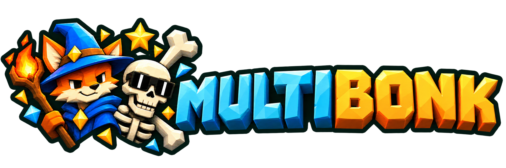

# MegaBonk Multiplayer — Multibonk



Community co-op for MegaBonk using MelonLoader. This is an unofficial mod, not an official multiplayer update.

**[Website](https://multibonk.ludix.gg/)** · **[Email a private bug report](https://multibonk.ludix.gg/#bugs)** · **[Download the latest release](https://github.com/Namigator/megabonk-multiplayer/releases/latest)** · **[All versions](https://github.com/Namigator/megabonk-multiplayer/releases)** · **[Report a bug](https://github.com/Namigator/megabonk-multiplayer/issues/new/choose)**

Current release: **v0.2.5 · network protocol 111**. Every player must install the same release and game version.

## Requirements

- An owned Windows x64 copy of **MegaBonk**. The tested game build is **1.0.69**; compatibility with other builds is unverified.
- **[MelonLoader 0.7.3](https://github.com/LavaGang/MelonLoader/releases/tag/v0.7.3)**, x64 / IL2CPP.
- The [.NET 6 Desktop Runtime, x64](https://dotnet.microsoft.com/en-us/download/dotnet/6.0) required by this loader. Follow the [official MelonLoader installation guide](https://github.com/LavaGang/MelonLoader#requirements).
- `Multibonk.dll` from this repository's Releases page. The game and MelonLoader are not bundled.

## Install on every player's PC

1. Close MegaBonk. Back up your saves and any existing `Mods/Multibonk.dll`.
2. In Steam, right-click **MegaBonk → Manage → Browse local files** to find the folder containing `Megabonk.exe`.
3. Install MelonLoader **0.7.3** for `Megabonk.exe`. Start the game once, let loader initialization finish, then close it.
4. Download `Multibonk-v0.2.5-protocol111.zip` from [Releases](https://github.com/Namigator/megabonk-multiplayer/releases/latest) and extract it.
5. Copy the ZIP's `Mods/Multibonk.dll` into your game's `Mods` folder, replacing the old DLL. Keep only one copy of Multibonk in that folder.
6. Start the game with the port option below. **F5** opens the Multibonk connection panel.

Expected layout:

```text
Megabonk/
  Megabonk.exe
  MelonLoader/            (installed separately)
  Mods/
    Multibonk.dll
```

Existing users can download the standalone `Multibonk.dll` release asset and replace only that file while the game is closed.

## Host and join

Use **TCP 35565** for this guide. In Steam's **MegaBonk → Properties → General → Launch Options**, enter:

```text
--multibonk-port 35565
```

The optional `Launch-Multibonk.ps1` in the ZIP also launches the game on 35565 when copied beside `Megabonk.exe`. Without an explicit option or this script, the mod defaults to TCP **25565**; entering an address without a port also assumes 25565. Always include `:35565` when joining this setup.

1. Everyone starts the game and selects a character.
2. The host presses **F5 → Host**. Allow the game through Windows Firewall on TCP 35565.
3. Other players press **F5**, enter `HOST_ADDRESS:35565`, and click **Join**.
4. Once the party appears in the panel, the host selects **Start Game**, or presses **F8**.

### Same home network / LAN

- The host runs `ipconfig` and finds the IPv4 address of their active Ethernet/Wi-Fi adapter.
- Friends join that LAN address, for example `192.168.1.20:35565`.
- Router port forwarding is unnecessary on the same LAN. The host's firewall still needs to allow TCP 35565.
- Guest Wi-Fi / client isolation can prevent devices on the same router from reaching each other.

### Different networks / internet

- The host forwards **TCP 35565 → TCP 35565** to their PC's LAN IPv4 address in the router and allows that port through Windows Firewall.
- Friends join the host's public IPv4 address followed by `:35565`.
- Carrier-grade NAT or a second router can prevent direct inbound connections. No Steam-invite or built-in relay service is included.
- Forward only the gameplay port. The local control socket is not needed for players and must not be exposed.

## Included gameplay

[PROXY] The current release contains host-authoritative enemies and stage progression, shared XP/level/gold, synchronized level-up choices, party reward pauses and waiting messages, and remote player/attack visuals.

- Chest and supported shrine reward choices are shared with current living, loaded participants. Each player makes their own choice; a single interaction does not charge every player again.
- Bosses produce **one shared chest**; its reward choice is shared with the party.
- Merchant and microwave transactions remain personal because they depend on personal inventory.
- Downed-player and party-wipe handling is included. A separate manual revive mechanic is not implemented.

## Current testing status and known issues

[RAN] The distributed DLL compiled successfully and was loaded into two actual local game instances. [SAW] Host/client gameplay was inspected. The project owner reports that the portal transition works in their test. These checks do not establish every item, weapon, game build or network configuration.

- **Remote character materials/textures:** some remote characters can render bright magenta or with missing/incorrect appearance. This is an unresolved rendering issue, not an intended skin color.
- **Remote attack effects:** effects can differ from the owning player's native VFX. Full visual parity is not established; hats are not synchronized.
- A native live-particle array capture path crashed in testing. **That path is disabled in this release**; particle rendering uses the prefab seed/time fallback. Do not use older development DLLs with the same internal protocol number in a party with this release: install the exact release asset on every PC.
- Downed players cannot use the normal portal interaction. A living participant can activate the portal. Manual revive is on the backlog.
- Game builds other than 1.0.69, Linux/Steam Deck and conflicting gameplay mods have not been verified for this release.

## Troubleshooting

- **No F5 panel:** check MelonLoader initialized and the DLL is directly inside `Mods`, not a nested folder. Read `MelonLoader/Latest.log`.
- **Cannot connect:** start Host first, include the port in the address, and check the host firewall. For WAN, also check the router forwarding/public address. A joining Windows PC can run `Test-NetConnection HOST_ADDRESS -Port 35565` in PowerShell.
- **Version mismatch / disconnect:** install the exact same release DLL and game build on every PC, then restart all players.
- **Missing textures / simplified effects:** this is a known visual issue; please attach a screenshot and affected character/skin or weapon to an issue.
- **Unexpected behavior:** preserve both host and client `MelonLoader/Latest.log` files before relaunching.

## Report bugs and request features

Anyone with a GitHub account can [open an issue](https://github.com/Namigator/megabonk-multiplayer/issues/new/choose). Include the mod/game/loader versions, host or client role, player count, steps to reproduce, expected/actual behavior, and relevant logs or screenshots. Remove personal information from logs before posting them publicly.

## Updates and uninstalling

- Versions and downloadable DLLs/ZIPs are kept under [Releases](https://github.com/Namigator/megabonk-multiplayer/releases). Close the game before replacing the DLL; all players update together.
- To remove Multibonk, close the game and remove `Mods/Multibonk.dll`, or restore the previous DLL backup. MelonLoader can be removed separately using its own instructions.

## Credits and license

- Original multiplayer mod: **Guilherme Luiz (2025)**.
- Server-authoritative rewrite: **AvinadavCoh (2026)**.
- Development assistance: **OpenAI Codex**.
- [MelonLoader](https://github.com/LavaGang/MelonLoader), Harmony and Il2CppInterop are provided by the user's separate loader installation.
- [Co-op Anything](https://github.com/cranebeaker/coop-anything) was used for development testing; its bot toolkit is not required or bundled in this player release.

The mod is distributed under the included [MIT license](LICENSE). MegaBonk game files, decompiled game source and loader binaries are excluded.

## Branding

The website and package feature original AI-generated fan illustrations of wizard Fox and Calcium, created with OpenAI’s built-in image-generation tool using character references. MegaBonk characters and trademarks belong to their respective owners. This is an unofficial project. New branding changes neither the published v0.2.5 gameplay DLL nor protocol111. The prepared Thunderstore0.2.6 package contains that same DLL.
